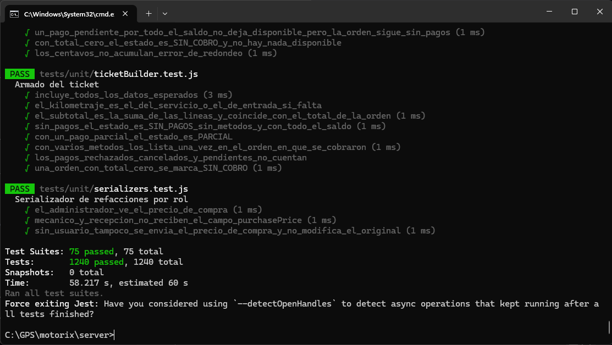

# Aseguramiento de la calidad - Sprint 5: Precios de refacciones y cobro completo

Este documento es el registro de calidad del Sprint 5 de Motorix. Reúne las puertas de calidad, las decisiones, los riesgos, la trazabilidad de los criterios de aceptación, los hallazgos, la regresión de los sprints 1 a 4 y el control de calidad final, con sus evidencias.

Resultado general: en curso. El documento se cierra después de `/speckit.implement`.

## 0. Datos del documento

| Campo | Valor |
|---|---|
| Sprint | 5 - Precios de refacciones y cobro completo |
| Insumo | `docs/sprints/sprint-5-precios-refacciones-cobro.md` |
| Rama | `005-precios-refacciones-cobro` |
| Responsable | Jorge Francisco Dominguez Ramirez, representante del proyecto |
| Fecha de inicio | 2026-11-03 |
| Fecha de cierre | Pendiente (se llena al cierre) |
| Estado general | En curso |

## 1. Objetivo y alcance

**Objetivo.** Asegurar que el Sprint 5 salga con calidad: que los requisitos estén completos, sean medibles y no se contradigan, que las pruebas estén planeadas antes del código y que el cambio no rompa lo construido en los sprints 1 a 4.

**Dentro del alcance:** categoría, marca y precios de compra y de venta de las refacciones; total de la orden con refacciones; pago y ticket con el nuevo total; conservación de pagos y tickets ya emitidos; visibilidad del precio de compra por rol.

**Fuera del alcance:** lo que el insumo del sprint lista en su sección 8: costeo, margen y reportes financieros; impuestos y facturación electrónica; descuentos, promociones y pagos a plazos; reembolsos; proveedores y órdenes de compra; notificaciones, reportes, configuración del taller y WhatsApp; fotos del vehículo y puesta en producción.

## 2. Criterios de entrada y de salida

Los criterios se marcan `[x]` solo cuando se cumplen de verdad. Hoy el sprint está antes de `/speckit.specify`.

**Criterios de entrada (para comenzar la implementación):**

- [ ] Las 8 puertas de la sección 3 están Aprobadas o Aprobadas con observación.
- [ ] La enmienda de la constitución (hallazgo H-03) está aprobada y registrada.
- [ ] Las decisiones de la sección 4 están resueltas y registradas.
- [ ] No hay hallazgos críticos ni altos abiertos en el análisis de consistencia.
- [ ] Cada criterio de aceptación tiene al menos una prueba planeada (sección 6).
- [x] La línea base de regresión está registrada (sección 8), con sus capturas.
- [ ] La documentación desfasada de los sprints anteriores está identificada.

**Criterios de salida (para cerrar el sprint):**

- [ ] Los 13 criterios de aceptación están Aprobados.
- [ ] Todas las pruebas de los sprints 1 a 4 siguen pasando.
- [ ] No hay defectos críticos ni altos abiertos (sección 7).
- [ ] La matriz de calidad final (sección 9) está completa, con evidencia.
- [ ] Reporte, análisis y matriz no se contradicen.

## 3. Puertas de calidad

Cada puerta se verifica antes de comenzar la implementación. El detalle de cada una está en los documentos citados en la columna de evidencia.

| ID | Puerta | Estado | Evidencia |
|:--:|---|---|---|
| G-01 | Insumo del sprint revisado contra el código | Aprobado con observación | `docs/sprints/sprint-5-precios-refacciones-cobro.md` reformulado el 2026-11-03 (H-02, H-04 a H-06). Observación: la enmienda de la constitución (H-03) sigue abierta y dos puntos del código quedan por decidir en `/speckit.clarify` (D-06 y D-07 del insumo) |
| G-02 | Especificación (`/speckit.specify`) | Pendiente | |
| G-03 | Aclaraciones (`/speckit.clarify`) | Pendiente | |
| G-04 | Lista de calidad de requisitos (`/speckit.checklist`) | Pendiente | |
| G-05 | Plan (`/speckit.plan`) | Pendiente | |
| G-06 | Tareas (`/speckit.tasks`) | Pendiente | |
| G-07 | Consistencia (`/speckit.analyze`) | Pendiente | |
| G-08 | Pruebas planeadas y línea base | Pendiente | Línea base registrada y con capturas (sección 8); faltan las pruebas planeadas por criterio |

## 4. Decisiones de aclaración

Pendiente: se llena después de `/speckit.clarify`. El insumo reformulado lista 7 decisiones abiertas (D-01 a D-07) en su sección 9.

## 5. Riesgos y mitigaciones

Pendiente: se llena antes de `/speckit.implement`, con la prueba concreta que cubre cada riesgo.

## 6. Trazabilidad

Pendiente: se llena antes de `/speckit.implement`, con una fila por cada uno de los 14 criterios de aceptación del insumo.

## 7. Hallazgos y defectos

Se registra todo lo que se encuentre, sea en los documentos, en el análisis o en las pruebas.

| ID | Descripción | Severidad (crítica, alta, media, baja) | Origen (puerta o prueba) | Estado | Resolución | Evidencia |
|:--:|---|---|---|---|---|---|
| H-01 | La prueba `recepcion_filtra_por_estado_por_mecanico_y_por_fecha` calculaba «hoy» y «mañana» en UTC, pero la base guarda la fecha local. Entre las 18:00 y las 24:00 (UTC-6) el filtro devolvía 0 órdenes en lugar de 3 y la línea base salía con 1 prueba fallida | Baja | Línea base | Resuelto | La prueba usa ahora la fecha local. No cambió ningún comportamiento del sistema | Commit `75b1da8`; `server/tests/integration/orders.read.test.js` |
| H-02 | El insumo afirma que las refacciones no tienen categoría, marca ni precios, y que el total de la orden no las incluye. El código ya hace casi todo eso: `parts` tiene `category`, `brand`, `purchasePrice` y `salePrice` desde la migración 003; `order_parts` guarda `unitPrice` (el precio de venta vigente al agregar la línea) y `amount`; `recalculateTotal` suma servicios, mano de obra y refacciones; el ticket ya incluye las refacciones con precio e importe; y el precio de compra ya se oculta a quien no es administrador | Alta | G-01 | Resuelto | El responsable eligió reformular el insumo (2026-11-03). Ahora el sprint endurece y demuestra lo existente: límites y reglas de precio, ocultar el precio de venta al mecánico (hoy lo recibe), probar que un cambio de precio no altera lo emitido, seeds y documentación. Quedó con 13 criterios de aceptación y 7 decisiones | `database/migrations/003_sprint3_maintenance_inventory.sql`; `server/models/orderModel.js` (`recalculateTotal`); `server/services/orderPartService.js`; `server/services/ticketBuilder.js`; `server/services/serializers.js` |
| H-03 | La constitución (principio I) fija el desarrollo en los sprints 1 a 4; el Sprint 5 es posterior al MVP y requiere una enmienda aprobada | Media | G-01 | Abierto | Pendiente: la enmienda la aprueba el responsable del proyecto antes de implementar | `.specify/memory/constitution.md`, principio I |
| H-04 | El insumo cita `docs/sprints/propuesta-sprints-post-mvp.md`, que no existe en el repositorio | Baja | G-01 | Resuelto | Se quitó la referencia del insumo | `docs/sprints/sprint-5-precios-refacciones-cobro.md`, línea 12 |
| H-05 | El insumo menciona el error `NOTHING_TO_CHARGE`, que no existe en el código; una orden con total cero responde `ORDER_NOT_PAYABLE` («La orden tiene total cero y no admite pagos.») | Baja | G-01 | Resuelto | El insumo reformulado ya no lo cita. Además, una orden con solo refacciones sí es cobrable, porque el único bloqueo es el total cero | `server/services/paymentService.js`, línea 39 |
| H-06 | El insumo daba por rechazado el importe que no coincide con el total y dejaba los pagos parciales fuera de alcance, pero desde el Sprint 4 el pago se valida contra el saldo disponible: admite pagos parciales y solo rechaza el que lo excede (`PAYMENT_EXCEEDS_BALANCE`) | Media | G-01 | Resuelto | CA-5 del insumo se reescribió con la regla real y la sección 8 aclara que los pagos parciales ya existen y no se tocan | `server/services/paymentService.js`, líneas 28 a 50 |

## 8. Línea base de regresión

Se ejecuta la suite completa **antes** de tocar el código y de nuevo **al cierre**. Ninguna prueba de los sprints 1 a 4 debe pasar de verde a rojo.

| Suite | Comando | Antes del sprint 5 | Después del sprint 5 | Diferencia | Evidencia |
|---|---|---|---|---|---|
| Backend (Jest) | `npm test` en `server/` | 75 suites y 1240 pruebas aprobadas, 0 fallidas | Pendiente (cierre) | Pendiente | Capturas abajo |
| Frontend (Flutter) | `flutter test` en `client/` | 242 pruebas aprobadas, 0 fallidas | Pendiente (cierre) | Pendiente | Capturas abajo |

**Fecha de la línea base:** 2026-11-03, sobre el commit `75b1da8` de la rama `sdd-speckit`, antes de crear la rama del sprint. El primer intento, sobre el commit `ecbe3d6`, dio 1239 de 1240 pruebas en el backend por el defecto H-01; se corrigió y la suite completa se repitió con 1240 de 1240.

**Capturas de la línea base (2026-11-03):**

**Duración del backend:** 58 s al inicio, según la captura. La del cierre está pendiente.
