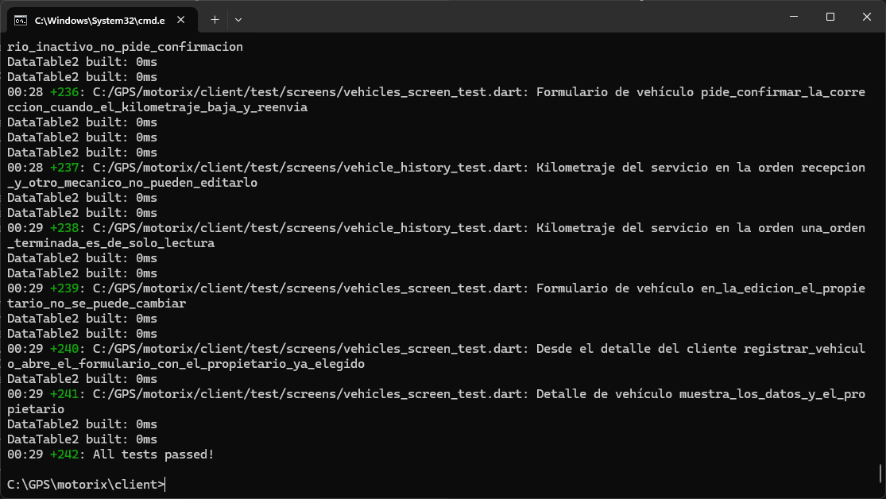

# Aseguramiento de la calidad - Sprint 5: Precios de refacciones y cobro completo

Este documento es el registro de calidad del Sprint 5 de Motorix. Reúne las puertas de calidad, las decisiones, los riesgos, la trazabilidad de los criterios de aceptación, los hallazgos, la regresión de los sprints 1 a 4 y el control de calidad final, con sus evidencias.

Resultado general: en curso. El documento se cierra después de `/speckit.implement`.

## 0. Datos del documento

| Campo | Valor |
|---|---|
| Sprint | 5 - Precios de refacciones y cobro completo |
| Insumo | `docs/sprints/sprint-5-precios-refacciones-cobro.md` |
| Rama | `005-precios-refacciones-cobro` |
| Responsable | Jorge Francisco Dominguez Ramirez, representante del proyecto |
| Fecha de inicio | 2026-11-03 |
| Fecha de cierre | Pendiente (se llena al cierre) |
| Estado general | En curso |

## 1. Objetivo y alcance

**Objetivo.** Asegurar que el Sprint 5 salga con calidad: que los requisitos estén completos, sean medibles y no se contradigan, que las pruebas estén planeadas antes del código y que el cambio no rompa lo construido en los sprints 1 a 4.

**Dentro del alcance:** categoría, marca y precios de compra y de venta de las refacciones; total de la orden con refacciones; pago y ticket con el nuevo total; conservación de pagos y tickets ya emitidos; visibilidad del precio de compra por rol.

**Fuera del alcance:** lo que el insumo del sprint lista en su sección 8: costeo, margen y reportes financieros; impuestos y facturación electrónica; descuentos, promociones y pagos a plazos; reembolsos; proveedores y órdenes de compra; notificaciones, reportes, configuración del taller y WhatsApp; fotos del vehículo y puesta en producción.

## 2. Criterios de entrada y de salida

Los criterios se marcan `[x]` solo cuando se cumplen de verdad. Hoy el sprint está antes de `/speckit.specify`.

**Criterios de entrada (para comenzar la implementación):**

- [x] Las 8 puertas de la sección 3 están Aprobadas o Aprobadas con observación.
- [x] La enmienda de la constitución (hallazgo H-03) está aprobada y registrada.
- [x] Las decisiones de la sección 4 están resueltas y registradas.
- [x] No hay hallazgos críticos ni altos abiertos en el análisis de consistencia.
- [x] Cada criterio de aceptación tiene al menos una prueba planeada (sección 6).
- [x] La línea base de regresión está registrada (sección 8), con sus capturas.
- [x] La documentación desfasada de los sprints anteriores está identificada (`docs/project-context.md`, `docs/design-system.md` y los textos que digan que el mecánico ve precios: CA-13, T004, T051 y T052).

**Criterios de salida (para cerrar el sprint):**

- [ ] Los 13 criterios de aceptación están Aprobados.
- [ ] Todas las pruebas de los sprints 1 a 4 siguen pasando.
- [ ] No hay defectos críticos ni altos abiertos (sección 7).
- [ ] La matriz de calidad final (sección 9) está completa, con evidencia.
- [ ] Reporte, análisis y matriz no se contradicen.

## 3. Puertas de calidad

Cada puerta se verifica antes de comenzar la implementación. El detalle de cada una está en los documentos citados en la columna de evidencia.

| ID | Puerta | Estado | Evidencia |
|:--:|---|---|---|
| G-01 | Insumo del sprint revisado contra el código | Aprobado con observación | `docs/sprints/sprint-5-precios-refacciones-cobro.md` reformulado el 2026-11-03 (H-02, H-04 a H-06). Observación: dos puntos del código quedan por decidir en `/speckit.clarify` (D-06 y D-07 del insumo) |
| G-02 | Especificación (`/speckit.specify`) | Aprobado | `specs/005-precios-refacciones-cobro/spec.md`: 5 historias de usuario, 23 requisitos funcionales y 7 criterios de éxito. Cada requisito indica si mantiene lo existente o agrega algo nuevo. Los 3 marcadores `[NEEDS CLARIFICATION]` iniciales se resolvieron en G-03 |
| G-03 | Aclaraciones (`/speckit.clarify`) | Aprobado | 5 decisiones resueltas en la sesión del 2026-11-03 (sección 4); sin marcadores `[NEEDS CLARIFICATION]`; D-06 y D-07 se respaldan con el código y el Sprint 4 |
| G-04 | Lista de calidad de requisitos (`/speckit.checklist`) | Aprobado | `specs/005-precios-refacciones-cobro/checklists/cobro.md`: 43 puntos revisados y resueltos (H-08 y H-09); los huecos se corrigieron en `spec.md` |
| G-05 | Plan (`/speckit.plan`) | Aprobado | `specs/005-precios-refacciones-cobro/plan.md`, `research.md`, `data-model.md`, `contracts/api.md` y `quickstart.md`. Constitución v1.1.0 sin violaciones (8 de 8 principios); sin migración 005 y sin seeds nuevos, porque ningún cambio exige columnas y los datos de ejemplo ya cubren el flujo; sin dependencias nuevas |
| G-06 | Tareas (`/speckit.tasks`) | Aprobado | `specs/005-precios-refacciones-cobro/tasks.md`: 59 tareas (1 de preparación, 3 de fundamentos, 15 en US1, 16 en US2, 7 en US3, 7 en US4, 4 en US5 y 6 de cierre), con las pruebas antes del código en cada historia, una tabla de cobertura de los 24 requisitos y tareas propias para el ajuste de pruebas por H-07 |
| G-07 | Consistencia (`/speckit.analyze`) | Aprobado | 2 pasadas el 2026-11-03. Pasada 1: 1 crítico, 0 altos, 1 medio y 5 bajos (H-10). Pasada 2, tras corregir: 0 críticos, 0 altos, 0 medios; queda 1 observación baja sin acción (seeds, constitución III). 26 de 26 requisitos con tarea (100 %) y 0 tareas sin requisito |
| G-08 | Pruebas planeadas y línea base | Aprobado | Los 13 criterios de aceptación tienen al menos una prueba planeada (sección 6) y los 11 riesgos tienen la prueba que los cubre (sección 5); línea base de 75 suites y 1240 pruebas de backend y 242 de frontend, con capturas (sección 8) |

## 4. Decisiones de aclaración

Las 7 decisiones abiertas del insumo (D-01 a D-07) se resolvieron el 2026-11-03: cinco en la etapa de aclaraciones, con la aprobación de Jorge Francisco Dominguez Ramirez, y dos con el comportamiento actual del código. El texto completo está en `specs/005-precios-refacciones-cobro/spec.md` (sección «Aclaraciones»).

| ID | Decisión | Resolución | Requisito afectado |
|:--:|---|---|---|
| D-01 | Precios que ve el mecánico | Ninguno: ni precio de compra ni de venta, ni importes de línea, ni desglose, ni el total de la orden | FR-008 |
| D-02 | Venta menor a compra | Advertir y pedir confirmación explícita antes de guardar | FR-004 |
| D-03 | Precio de venta 0 | Se permite, como hoy | FR-004-b |
| D-04 | Límites máximos | 99,999,999.99 para el precio, la línea y el total | FR-002, FR-003 |
| D-05 | Corregir el precio de una línea | Fuera del sprint: se quita la refacción y se agrega de nuevo | FR-020 |
| D-06 | Orden Terminada que vuelve a estar en curso | No ocurre: Terminada solo pasa a Entregada (`orderStateMachine.js`) | Supuestos |
| D-07 | Contenido del ticket | Se sigue armando al consultarlo con los datos de la orden (aclaración del Sprint 4) | Supuestos |

## 5. Riesgos y mitigaciones

Los riesgos se evaluaron antes de implementar, por eso su estado es Abierto; pasan a Mitigado cuando la prueba que los cubre exista y pase.

| ID | Riesgo | Impacto | Mitigación | Prueba que lo cubre | Estado |
|:--:|---|---|---|---|---|
| R-01 | Un cambio de precio altera una línea, el total, un pago o un ticket ya registrados | Alto: importes incorrectos en el historial de dinero | El precio se guarda en la línea al agregarla (ya existe) y las órdenes Terminadas o Entregadas no admiten cambios; se demuestra con pruebas y una prueba de mutación | `orderParts.prices.test.js`, `orderParts.prices.concurrency.test.js`, `emitted.compat.test.js` (T036 a T038, T041) | Abierto |
| R-02 | El precio de compra llega a recepción o al mecánico, o el precio de venta, los importes o el total llegan al mecánico, por alguna ruta | Alto: fuga de información financiera del taller | Serializadores por rol en el servidor y recorrido de todas las rutas de lectura con cada rol, con prueba de mutación | `serializers.test.js`, `prices.leak.test.js`, `orders.mechanicView.test.js` (T020 a T022, T034) | Abierto |
| R-03 | Una ruta nueva o una ruta de escritura que devuelve el detalle de la orden se olvida en la restricción del mecánico | Alto | El serializador se aplica en `conPermisos` y en el listado, y el recorrido incluye las rutas de escritura de servicios, mano de obra y refacciones | `orders.mechanicView.test.js`, `prices.leak.test.js` (T021, T022) | Abierto |
| R-04 | Ajustar las pruebas anteriores por el cambio de contrato del mecánico debilita las pruebas sin que quede registro | Medio: se pierde cobertura de los Sprints 1 a 4 | Solo cambian las aserciones del rol mecánico, cada ajuste se registra en H-07 y la regresión completa compara contra la línea base (1240 y 242 pruebas) | Revisión del diff de `server/tests/` y `client/test/` y regresión completa (T031 a T033, T054, T055) | Abierto |
| R-05 | Un importe de línea o un total superior a 99,999,999.99 termina en un error de la base y deja la operación a medias | Alto: inventario y orden inconsistentes | Validar en centavos antes de escribir, dentro de la transacción que bloquea la orden, y probar la atomicidad con un fallo forzado | `orderLimits.test.js`, `orders.limits.test.js`, `orderParts.atomic.test.js` (T005, T009, T040) | Abierto |
| R-06 | El total de la orden, el pago y el ticket no coinciden por un error de redondeo de la mano de obra | Alto: comprobante incorrecto para el cliente | Cálculo en centavos y pruebas de valores límite de la mano de obra (horas decimales por tarifa) | `orderTotals.test.js`, `billing.parts.test.js`, `tickets.parts.test.js` (T043 a T045) | Abierto |
| R-07 | Cobros simultáneos superan el total de la orden con refacciones | Alto | Se conserva el bloqueo de la orden del Sprint 4 y se vuelve a probar con refacciones | `billing.parts.test.js` y las pruebas de concurrencia de pagos del Sprint 4, que deben seguir en verde (T044, T054) | Abierto |
| R-08 | Se guarda por error una venta menor al costo | Medio: pérdida económica por captura | Rechazo en el servidor salvo confirmación explícita, y diálogo de confirmación en el formulario | `partService.test.js`, `parts.prices.test.js`, `part_form_test.dart` (T006, T008, T011) | Abierto |
| R-09 | Las pantallas del mecánico muestran ceros o marcadores donde antes iba un precio, o fallan al no recibir el campo | Medio: interfaz confusa o con errores | Campos opcionales en los modelos del cliente y pantallas que los omiten; pruebas de Flutter con la sesión del mecánico | `mechanic_prices_test.dart` y las pruebas de Flutter ajustadas (T023, T029, T030, T032) | Abierto |
| R-10 | La documentación vuelve a desfasarse del código (entidad `Part`, visibilidad de precios, confirmaciones) | Bajo: contradicciones entre documentos y código | Actualizar `project-context.md` y `design-system.md` dentro del sprint, esta última antes de cambiar pantallas (principio VIII) | Revisión documental (T004, T051, T052, T059) | Abierto |
| R-11 | Los seeds actuales no bastan para demostrar el flujo o se duplican al cargarse de nuevo | Bajo | Verificar con una prueba que los seeds son idempotentes y que hay una orden Terminada con refacciones y saldo pendiente | `seeds.sprint5.test.js` (T050, T053) | Abierto |

## 6. Trazabilidad

Cada criterio de aceptación (CA) del insumo se enlaza con su requisito, su tarea, su prueba y el resultado. Antes de implementar, el resultado es Pendiente en todos; se actualiza al cierre con la evidencia real.

| CA | Criterio de aceptación (resumen) | Requisito (FR) | Tarea | Prueba | Resultado | Evidencia |
|:--:|---|---|---|---|---|---|
| CA-1 | Precios con dos decimales, no negativos y con límites máximos de precio, línea y total | FR-001, FR-002, FR-003 | T013, T014, T016, T017 | T005, T007, T008, T009, T010 | Pendiente | `orderLimits.test.js`, `partValidator.test.js`, `parts.prices.test.js`, `orders.limits.test.js` |
| CA-2 | Venta menor al costo: advertencia y confirmación explícita; precio 0 permitido | FR-004, FR-004-b | T004, T014, T015, T018 | T006, T008, T011 | Pendiente | `partService.test.js`, `parts.prices.test.js`, `part_form_test.dart` |
| CA-3 | La línea conserva el precio vigente al agregarla; un cambio posterior no la modifica, también con solicitudes simultáneas | FR-010, FR-014, FR-020 | T036 a T042 (demostración del comportamiento existente) | T036, T037, T041 | Pendiente | `orderParts.prices.test.js`, `orderParts.prices.concurrency.test.js` |
| CA-4 | Total = servicios + mano de obra + refacciones, en centavos, con redondeo definido | FR-011 | T043, T048, T049 | T043, T048 | Pendiente | `orderTotals.test.js` |
| CA-5 | El pago se valida contra el saldo disponible; una orden con solo refacciones se cobra; Mercado Pago recibe el importe correcto | FR-015, FR-016, FR-017 | T044, T048, T049 | T044 | Pendiente | `billing.parts.test.js` |
| CA-6 | Pagos y tickets emitidos conservan su importe y contenido; una orden Cancelada conserva líneas, precios y total | FR-012, FR-012-b, FR-013 | T038, T039, T041 | T038, T039 | Pendiente | `emitted.compat.test.js`, `orderParts.cancel.test.js` |
| CA-7 | El ticket incluye cantidad, precio unitario e importe de cada refacción y su subtotal coincide con el total | FR-018 | T045, T047, T049 | T045, T047 | Pendiente | `tickets.parts.test.js`, `ticket_screen_test.dart` |
| CA-8 | El mecánico no recibe ningún precio ni importe de refacciones ni el total, validado en el servidor, y sigue usando las refacciones | FR-007, FR-008, FR-009 | T025 a T030, T034 | T020, T021, T022, T023 | Pendiente | `serializers.test.js`, `prices.leak.test.js`, `orders.mechanicView.test.js`, `mechanic_prices_test.dart` |
| CA-9 | Recepción recibe el precio de venta y los importes, pero nunca el precio de compra; solo el administrador lo recibe | FR-005, FR-006 | T025, T027 | T020, T021 | Pendiente | `serializers.test.js`, `prices.leak.test.js` |
| CA-10 | El panel de control y los listados de órdenes y pagos funcionan con el nuevo total | FR-019 | T046, T049 | T046, T047 | Pendiente | `dashboard.listings.regression.test.js` |
| CA-11 | Hay refacciones con precios y una orden Terminada cobrable con refacciones; los seeds son idempotentes y no se agregan seeds ni migración | FR-021 | T050, T053 | T050 | Pendiente | `seeds.sprint5.test.js` |
| CA-12 | Se mantienen las reglas del Sprint 4: sin datos de tarjeta, permisos en el servidor y operaciones de refacciones todo o nada | FR-009, FR-017, FR-024 | T040, T044 | T040, T044 | Pendiente | `orderParts.atomic.test.js`, `billing.parts.test.js` |
| CA-13 | La documentación y los comentarios del código se actualizan en el mismo sprint | FR-023 | T004, T051, T052, T059 | Revisión documental (sin prueba automática) | Pendiente | `project-context.md`, `design-system.md`, `README.md` |

Las pruebas de regresión de los Sprints 1 a 4 y las del propio sprint (FR-022) se miden en la sección 8 con la línea base de 75 suites y 1240 pruebas de backend y 242 de frontend.

## 7. Hallazgos y defectos

Se registra todo lo que se encuentre, sea en los documentos, en el análisis o en las pruebas.

| ID | Descripción | Severidad (crítica, alta, media, baja) | Origen (puerta o prueba) | Estado | Resolución | Evidencia |
|:--:|---|---|---|---|---|---|
| H-01 | La prueba `recepcion_filtra_por_estado_por_mecanico_y_por_fecha` calculaba «hoy» y «mañana» en UTC, pero la base guarda la fecha local. Entre las 18:00 y las 24:00 (UTC-6) el filtro devolvía 0 órdenes en lugar de 3 y la línea base salía con 1 prueba fallida | Baja | Línea base | Resuelto | La prueba usa ahora la fecha local. No cambió ningún comportamiento del sistema | Commit `75b1da8`; `server/tests/integration/orders.read.test.js` |
| H-02 | El insumo afirma que las refacciones no tienen categoría, marca ni precios, y que el total de la orden no las incluye. El código ya hace casi todo eso: `parts` tiene `category`, `brand`, `purchasePrice` y `salePrice` desde la migración 003; `order_parts` guarda `unitPrice` (el precio de venta vigente al agregar la línea) y `amount`; `recalculateTotal` suma servicios, mano de obra y refacciones; el ticket ya incluye las refacciones con precio e importe; y el precio de compra ya se oculta a quien no es administrador | Alta | G-01 | Resuelto | El responsable eligió reformular el insumo (2026-11-03). Ahora el sprint endurece y demuestra lo existente: límites y reglas de precio, ocultar el precio de venta al mecánico (hoy lo recibe), probar que un cambio de precio no altera lo emitido, seeds y documentación. Quedó con 13 criterios de aceptación y 7 decisiones | `database/migrations/003_sprint3_maintenance_inventory.sql`; `server/models/orderModel.js` (`recalculateTotal`); `server/services/orderPartService.js`; `server/services/ticketBuilder.js`; `server/services/serializers.js` |
| H-03 | La constitución (principio I) fija el desarrollo en los sprints 1 a 4; el Sprint 5 es posterior al MVP y requiere una enmienda aprobada | Media | G-01 | Resuelto | Enmienda MINOR 1.1.0 registrada el 2026-11-03 en el principio I: el Sprint 5 es el primer sprint posterior al MVP y todo sprint posterior requiere la aprobación del representante del proyecto (autoridad declarada por quien lo lleva, por ser un proyecto escolar) | `.specify/memory/constitution.md`, principio I y versión 1.1.0 |
| H-04 | El insumo cita `docs/sprints/propuesta-sprints-post-mvp.md`, que no existe en el repositorio | Baja | G-01 | Resuelto | Se quitó la referencia del insumo | `docs/sprints/sprint-5-precios-refacciones-cobro.md`, línea 12 |
| H-05 | El insumo menciona el error `NOTHING_TO_CHARGE`, que no existe en el código; una orden con total cero responde `ORDER_NOT_PAYABLE` («La orden tiene total cero y no admite pagos.») | Baja | G-01 | Resuelto | El insumo reformulado ya no lo cita. Además, una orden con solo refacciones sí es cobrable, porque el único bloqueo es el total cero | `server/services/paymentService.js`, línea 39 |
| H-06 | El insumo daba por rechazado el importe que no coincide con el total y dejaba los pagos parciales fuera de alcance, pero desde el Sprint 4 el pago se valida contra el saldo disponible: admite pagos parciales y solo rechaza el que lo excede (`PAYMENT_EXCEEDS_BALANCE`) | Media | G-01 | Resuelto | CA-5 del insumo se reescribió con la regla real y la sección 8 aclara que los pagos parciales ya existen y no se tocan | `server/services/paymentService.js`, líneas 28 a 50 |
| H-07 | La decisión D-01 (FR-008) cambia un contrato existente: el mecánico hoy recibe el precio de venta, los importes de las líneas de refacción y el total de la orden, y a partir del sprint no recibirá ninguno. Las pruebas y las pantallas que dependen de esos datos deberán ajustarse | Media | G-03 | Abierto | Se resolverá en la implementación: se registrarán aquí las pruebas ajustadas y su razón. El plan ya lista las 16 rutas afectadas, 12 archivos de pruebas del backend candidatos, 6 pantallas y 6 pruebas de Flutter candidatas | `specs/005-precios-refacciones-cobro/spec.md`, FR-008; `specs/005-precios-refacciones-cobro/research.md`, punto 8 |
| H-08 | La revisión de la lista `cobro.md` (43 puntos) encontró huecos y ambigüedades: el límite del total no cubría servicios ni mano de obra y el código no lo valida; no estaba definido el comportamiento de las órdenes Canceladas; FR-016 se contradecía con los estados cobrables; el «redondeo» de las refacciones no existe porque la cantidad es entera (solo la mano de obra se redondea); «saldo» no coincidía con «saldo disponible»; el alcance del ocultamiento al mecánico, la confirmación de la venta menor al costo y varios términos vagos no estaban definidos | Media | G-04 (`cobro.md`) | Resuelto | Se corrigió `spec.md`: FR-001, FR-003, FR-004, FR-008, FR-010, FR-012-b, FR-015, FR-016, FR-019, FR-022, el nuevo FR-024, los criterios SC-001, SC-002, SC-003, SC-004, SC-005 y SC-006, los casos límite y los supuestos | `specs/005-precios-refacciones-cobro/checklists/cobro.md` |
| H-09 | El insumo seguía listando las decisiones D-01 a D-07 como pendientes después de resolverse | Baja | G-04 (CHK043) | Resuelto | La sección 9 del insumo indica que se resolvieron y remite a la especificación | `docs/sprints/sprint-5-precios-refacciones-cobro.md`, sección 9 |
| H-10 | El análisis de consistencia (pasada 1) encontró: la actualización de `docs/design-system.md` (T051 antes de la corrección, hoy T004) iba después de los cambios de pantalla, contra el principio VIII de la constitución (crítica); la especificación decía que el mecánico ve la «unidad» de una refacción, campo que no existe (media); y cuatro detalles bajos (el «desglose» inexistente, el término «pedido», una dependencia entre T045 y US2 y el ayudante de seeds de T049) | Crítica | G-07 (pasada 1) | Resuelto | Se movió la actualización de `docs/design-system.md` a los fundamentos (T004, antes de cualquier pantalla) y se renumeraron las tareas; se quitó la «unidad» y el «desglose» inexistentes de la especificación y el contrato; se usó «orden» en el plan y la investigación; se declaró que T046 depende de T026; y se precisó el ayudante de seeds (T050). La pasada 2 no encontró hallazgos críticos, altos ni medios | Informe de `/speckit.analyze` del 2026-11-03; `specs/005-precios-refacciones-cobro/tasks.md` |

## 8. Línea base de regresión

Se ejecuta la suite completa **antes** de tocar el código y de nuevo **al cierre**. Ninguna prueba de los sprints 1 a 4 debe pasar de verde a rojo.

| Suite | Comando | Antes del sprint 5 | Después del sprint 5 | Diferencia | Evidencia |
|---|---|---|---|---|---|
| Backend (Jest) | `npm test` en `server/` | 75 suites y 1240 pruebas aprobadas, 0 fallidas | Pendiente (cierre) | Pendiente | Capturas abajo |
| Frontend (Flutter) | `flutter test` en `client/` | 242 pruebas aprobadas, 0 fallidas | Pendiente (cierre) | Pendiente | Capturas abajo |

**Fecha de la línea base:** 2026-11-03, sobre el commit `75b1da8` de la rama `sdd-speckit`, antes de crear la rama del sprint. El primer intento, sobre el commit `ecbe3d6`, dio 1239 de 1240 pruebas en el backend por el defecto H-01; se corrigió y la suite completa se repitió con 1240 de 1240.

**Capturas de la línea base (2026-11-03):**

**Duración del backend:** 58 s al inicio, según la captura. La del cierre está pendiente.
