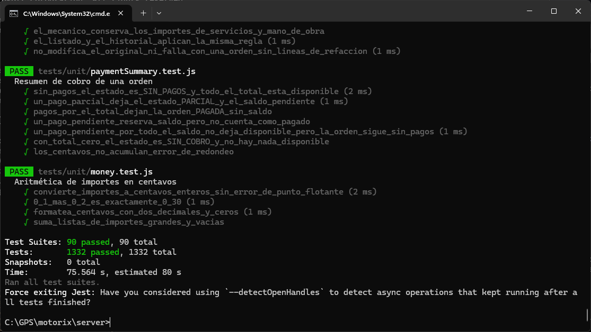
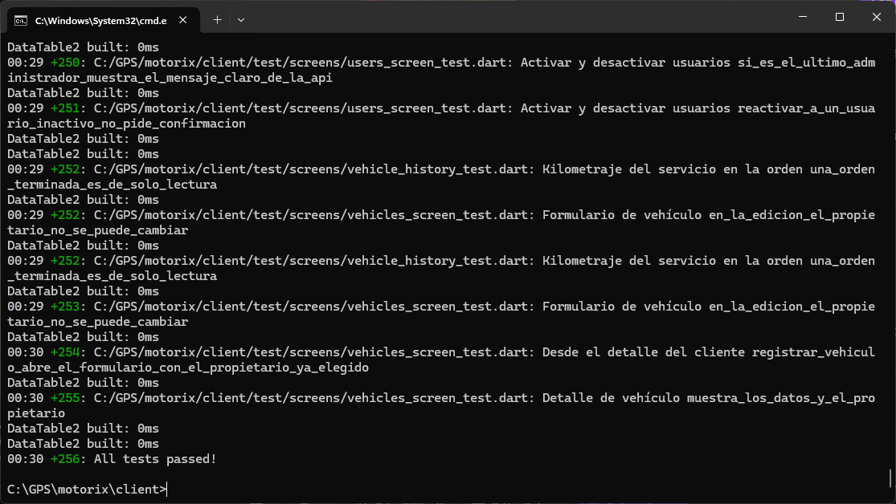
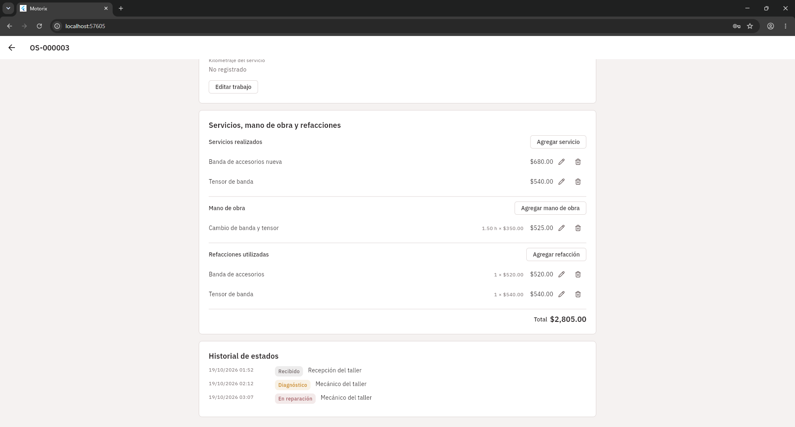
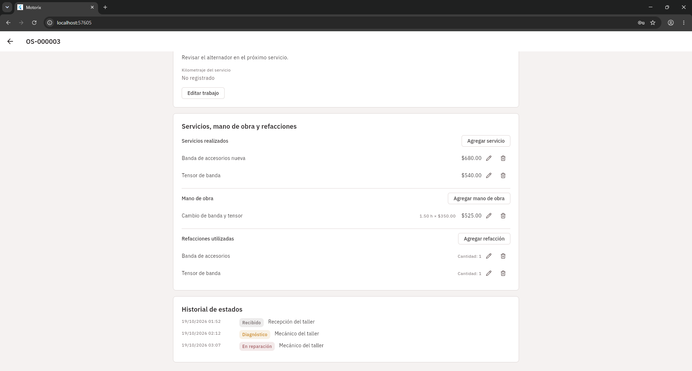
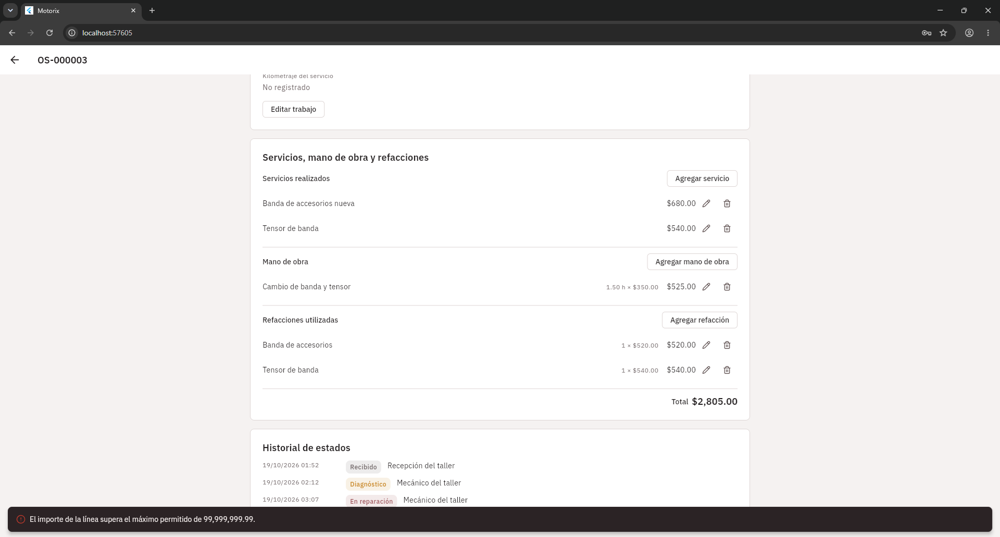
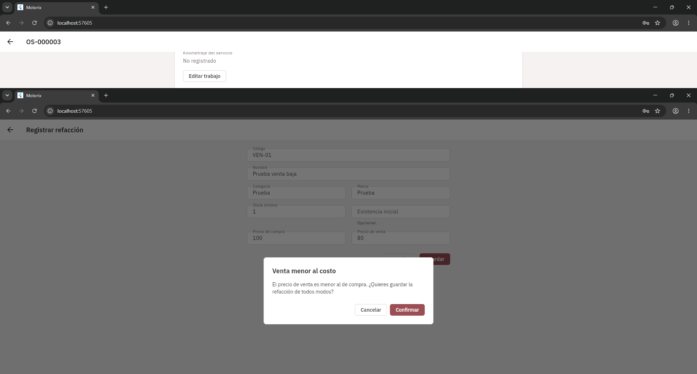
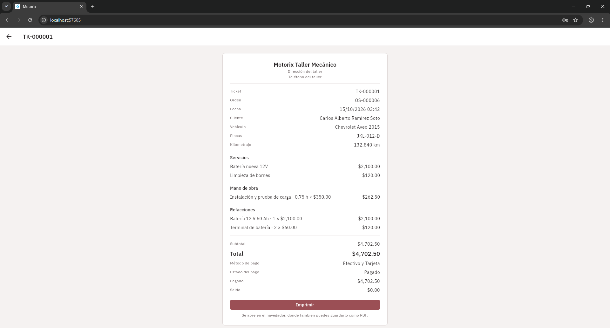

# Aseguramiento de la calidad - Sprint 5: Precios de refacciones y cobro completo

Este documento es el registro de calidad del Sprint 5 de Motorix. Reúne las puertas de calidad, las decisiones, los riesgos, la trazabilidad de los criterios de aceptación, los hallazgos, la regresión de los sprints 1 a 4 y el control de calidad final, con sus evidencias.

Resultado general: el sprint se aprobó con observaciones el 2026-11-03.

## 0. Datos del documento

| Campo | Valor |
|---|---|
| Sprint | 5 - Precios de refacciones y cobro completo |
| Insumo | `docs/sprints/sprint-5-precios-refacciones-cobro.md` |
| Rama | `005-precios-refacciones-cobro` |
| Responsable | Jorge Francisco Dominguez Ramirez, representante del proyecto |
| Fecha de inicio | 2026-11-03 |
| Fecha de cierre | 2026-11-03 |
| Estado general | Aprobado con observación |

## 1. Objetivo y alcance

**Objetivo.** Asegurar que el Sprint 5 salga con calidad: que los requisitos estén completos, sean medibles y no se contradigan, que las pruebas estén planeadas antes del código y que el cambio no rompa lo construido en los sprints 1 a 4.

**Dentro del alcance:** categoría, marca y precios de compra y de venta de las refacciones; total de la orden con refacciones; pago y ticket con el nuevo total; conservación de pagos y tickets ya emitidos; visibilidad del precio de compra por rol.

**Fuera del alcance:** lo que el insumo del sprint lista en su sección 8: costeo, margen y reportes financieros; impuestos y facturación electrónica; descuentos, promociones y pagos a plazos; reembolsos; proveedores y órdenes de compra; notificaciones, reportes, configuración del taller y WhatsApp; fotos del vehículo y puesta en producción.

## 2. Criterios de entrada y de salida

Los criterios se marcan `[x]` solo cuando se cumplen de verdad. Hoy el sprint está antes de `/speckit.specify`.

**Criterios de entrada (para comenzar la implementación):**

- [x] Las 8 puertas de la sección 3 están Aprobadas o Aprobadas con observación.
- [x] La enmienda de la constitución (hallazgo H-03) está aprobada y registrada.
- [x] Las decisiones de la sección 4 están resueltas y registradas.
- [x] No hay hallazgos críticos ni altos abiertos en el análisis de consistencia.
- [x] Cada criterio de aceptación tiene al menos una prueba planeada (sección 6).
- [x] La línea base de regresión está registrada (sección 8), con sus capturas.
- [x] La documentación desfasada de los sprints anteriores está identificada (`docs/project-context.md`, `docs/design-system.md` y los textos que digan que el mecánico ve precios: CA-13, T004, T051 y T052).

**Criterios de salida (para cerrar el sprint):**

- [x] Los 13 criterios de aceptación están Aprobados.
- [x] Todas las pruebas de los sprints 1 a 4 siguen pasando.
- [x] No hay defectos críticos ni altos abiertos (sección 7).
- [x] La matriz de calidad final (sección 9) está completa, con evidencia.
- [x] Reporte, análisis y matriz no se contradicen.

## 3. Puertas de calidad

Cada puerta se verifica antes de comenzar la implementación. El detalle de cada una está en los documentos citados en la columna de evidencia.

| ID | Puerta | Estado | Evidencia |
|:--:|---|---|---|
| G-01 | Insumo del sprint revisado contra el código | Aprobado con observación | `docs/sprints/sprint-5-precios-refacciones-cobro.md` reformulado el 2026-11-03 (H-02, H-04 a H-06). Observación: dos puntos del código quedan por decidir en `/speckit.clarify` (D-06 y D-07 del insumo) |
| G-02 | Especificación (`/speckit.specify`) | Aprobado | `specs/005-precios-refacciones-cobro/spec.md`: 5 historias de usuario, 23 requisitos funcionales y 7 criterios de éxito. Cada requisito indica si mantiene lo existente o agrega algo nuevo. Los 3 marcadores `[NEEDS CLARIFICATION]` iniciales se resolvieron en G-03 |
| G-03 | Aclaraciones (`/speckit.clarify`) | Aprobado | 5 decisiones resueltas en la sesión del 2026-11-03 (sección 4); sin marcadores `[NEEDS CLARIFICATION]`; D-06 y D-07 se respaldan con el código y el Sprint 4 |
| G-04 | Lista de calidad de requisitos (`/speckit.checklist`) | Aprobado | `specs/005-precios-refacciones-cobro/checklists/cobro.md`: 43 puntos revisados y resueltos (H-08 y H-09); los huecos se corrigieron en `spec.md` |
| G-05 | Plan (`/speckit.plan`) | Aprobado | `specs/005-precios-refacciones-cobro/plan.md`, `research.md`, `data-model.md`, `contracts/api.md` y `quickstart.md`. Constitución v1.1.0 sin violaciones (8 de 8 principios); sin migración 005 y sin seeds nuevos, porque ningún cambio exige columnas y los datos de ejemplo ya cubren el flujo; sin dependencias nuevas |
| G-06 | Tareas (`/speckit.tasks`) | Aprobado | `specs/005-precios-refacciones-cobro/tasks.md`: 59 tareas (1 de preparación, 3 de fundamentos, 15 en US1, 16 en US2, 7 en US3, 7 en US4, 4 en US5 y 6 de cierre), con las pruebas antes del código en cada historia, una tabla de cobertura de los 24 requisitos y tareas propias para el ajuste de pruebas por H-07 |
| G-07 | Consistencia (`/speckit.analyze`) | Aprobado | 2 pasadas el 2026-11-03. Pasada 1: 1 crítico, 0 altos, 1 medio y 5 bajos (H-10). Pasada 2, tras corregir: 0 críticos, 0 altos, 0 medios; queda 1 observación baja sin acción (seeds, constitución III). 26 de 26 requisitos con tarea (100 %) y 0 tareas sin requisito |
| G-08 | Pruebas planeadas y línea base | Aprobado | Los 13 criterios de aceptación tienen al menos una prueba planeada (sección 6) y los 11 riesgos tienen la prueba que los cubre (sección 5); línea base de 75 suites y 1240 pruebas de backend y 242 de frontend, con capturas (sección 8) |

## 4. Decisiones de aclaración

Las 7 decisiones abiertas del insumo (D-01 a D-07) se resolvieron el 2026-11-03: cinco en la etapa de aclaraciones, con la aprobación de Jorge Francisco Dominguez Ramirez, y dos con el comportamiento actual del código. El texto completo está en `specs/005-precios-refacciones-cobro/spec.md` (sección «Aclaraciones»).

| ID | Decisión | Resolución | Requisito afectado |
|:--:|---|---|---|
| D-01 | Precios que ve el mecánico | Ninguno: ni precio de compra ni de venta, ni importes de línea, ni desglose, ni el total de la orden | FR-008 |
| D-02 | Venta menor a compra | Advertir y pedir confirmación explícita antes de guardar | FR-004 |
| D-03 | Precio de venta 0 | Se permite, como hoy | FR-004-b |
| D-04 | Límites máximos | 99,999,999.99 para el precio, la línea y el total | FR-002, FR-003 |
| D-05 | Corregir el precio de una línea | Fuera del sprint: se quita la refacción y se agrega de nuevo | FR-020 |
| D-06 | Orden Terminada que vuelve a estar en curso | No ocurre: Terminada solo pasa a Entregada (`orderStateMachine.js`) | Supuestos |
| D-07 | Contenido del ticket | Se sigue armando al consultarlo con los datos de la orden (aclaración del Sprint 4) | Supuestos |

## 5. Riesgos y mitigaciones

Los riesgos se evaluaron antes de implementar y pasaron a Mitigado el 2026-11-03, cuando la prueba que los cubre existió y pasó.

| ID | Riesgo | Impacto | Mitigación | Prueba que lo cubre | Estado |
|:--:|---|---|---|---|---|
| R-01 | Un cambio de precio altera una línea, el total, un pago o un ticket ya registrados | Alto: importes incorrectos en el historial de dinero | El precio se guarda en la línea al agregarla (ya existe) y las órdenes Terminadas o Entregadas no admiten cambios; se demuestra con pruebas y una prueba de mutación | `orderParts.prices.test.js`, `orderParts.prices.concurrency.test.js`, `emitted.compat.test.js` (T036 a T038, T041) | Mitigado |
| R-02 | El precio de compra llega a recepción o al mecánico, o el precio de venta, los importes o el total llegan al mecánico, por alguna ruta | Alto: fuga de información financiera del taller | Serializadores por rol en el servidor y recorrido de todas las rutas de lectura con cada rol, con prueba de mutación | `serializers.test.js`, `prices.leak.test.js`, `orders.mechanicView.test.js` (T020 a T022, T034) | Mitigado |
| R-03 | Una ruta nueva o una ruta de escritura que devuelve el detalle de la orden se olvida en la restricción del mecánico | Alto | El serializador se aplica en `conPermisos` y en el listado, y el recorrido incluye las rutas de escritura de servicios, mano de obra y refacciones | `orders.mechanicView.test.js`, `prices.leak.test.js` (T021, T022) | Mitigado |
| R-04 | Ajustar las pruebas anteriores por el cambio de contrato del mecánico debilita las pruebas sin que quede registro | Medio: se pierde cobertura de los Sprints 1 a 4 | Solo cambian las aserciones del rol mecánico, cada ajuste se registra en H-07 y la regresión completa compara contra la línea base (1240 y 242 pruebas) | Revisión del diff de `server/tests/` y `client/test/` y regresión completa (T031 a T033, T054, T055) | Mitigado |
| R-05 | Un importe de línea o un total superior a 99,999,999.99 termina en un error de la base y deja la operación a medias | Alto: inventario y orden inconsistentes | Validar en centavos antes de escribir, dentro de la transacción que bloquea la orden, y probar la atomicidad con un fallo forzado | `orderLimits.test.js`, `orders.limits.test.js`, `orderParts.atomic.test.js` (T005, T009, T040) | Mitigado |
| R-06 | El total de la orden, el pago y el ticket no coinciden por un error de redondeo de la mano de obra | Alto: comprobante incorrecto para el cliente | Cálculo en centavos y pruebas de valores límite de la mano de obra (horas decimales por tarifa) | `orderTotals.test.js`, `billing.parts.test.js`, `tickets.parts.test.js` (T043 a T045) | Mitigado |
| R-07 | Cobros simultáneos superan el total de la orden con refacciones | Alto | Se conserva el bloqueo de la orden del Sprint 4 y se vuelve a probar con refacciones | `billing.parts.test.js` y las pruebas de concurrencia de pagos del Sprint 4, que deben seguir en verde (T044, T054) | Mitigado |
| R-08 | Se guarda por error una venta menor al costo | Medio: pérdida económica por captura | Rechazo en el servidor salvo confirmación explícita, y diálogo de confirmación en el formulario | `partService.test.js`, `parts.prices.test.js`, `part_form_test.dart` (T006, T008, T011) | Mitigado |
| R-09 | Las pantallas del mecánico muestran ceros o marcadores donde antes iba un precio, o fallan al no recibir el campo | Medio: interfaz confusa o con errores | Campos opcionales en los modelos del cliente y pantallas que los omiten; pruebas de Flutter con la sesión del mecánico | `mechanic_prices_test.dart` y las pruebas de Flutter ajustadas (T023, T029, T030, T032) | Mitigado |
| R-10 | La documentación vuelve a desfasarse del código (entidad `Part`, visibilidad de precios, confirmaciones) | Bajo: contradicciones entre documentos y código | Actualizar `project-context.md` y `design-system.md` dentro del sprint, esta última antes de cambiar pantallas (principio VIII) | Revisión documental (T004, T051, T052, T059) | Mitigado |
| R-11 | Los seeds actuales no bastan para demostrar el flujo o se duplican al cargarse de nuevo | Bajo | Verificar con una prueba que los seeds son idempotentes y que hay una orden Terminada con refacciones y saldo pendiente | `seeds.sprint5.test.js` (T050, T053) | Mitigado |

## 6. Trazabilidad

Cada criterio de aceptación (CA) del insumo se enlaza con su requisito, su tarea, su prueba y el resultado. Los 13 criterios quedaron Aprobados el 2026-11-03 con las pruebas de la columna Evidencia; CA-13 se aprobó por revisión documental.

| CA | Criterio de aceptación (resumen) | Requisito (FR) | Tarea | Prueba | Resultado | Evidencia |
|:--:|---|---|---|---|---|---|
| CA-1 | Precios con dos decimales, no negativos y con límites máximos de precio, línea y total | FR-001, FR-002, FR-003 | T013, T014, T016, T017 | T005, T007, T008, T009, T010 | Aprobado | `orderLimits.test.js`, `partValidator.test.js`, `parts.prices.test.js`, `orders.limits.test.js` |
| CA-2 | Venta menor al costo: advertencia y confirmación explícita; precio 0 permitido | FR-004, FR-004-b | T004, T014, T015, T018 | T006, T008, T011 | Aprobado | `partService.test.js`, `parts.prices.test.js`, `part_form_test.dart` |
| CA-3 | La línea conserva el precio vigente al agregarla; un cambio posterior no la modifica, también con solicitudes simultáneas | FR-010, FR-014, FR-020 | T036 a T042 (demostración del comportamiento existente) | T036, T037, T041 | Aprobado | `orderParts.prices.test.js`, `orderParts.prices.concurrency.test.js` |
| CA-4 | Total = servicios + mano de obra + refacciones, en centavos, con redondeo definido | FR-011 | T043, T048, T049 | T043, T048 | Aprobado | `orderTotals.test.js` |
| CA-5 | El pago se valida contra el saldo disponible; una orden con solo refacciones se cobra; Mercado Pago recibe el importe correcto | FR-015, FR-016, FR-017 | T044, T048, T049 | T044 | Aprobado | `billing.parts.test.js` |
| CA-6 | Pagos y tickets emitidos conservan su importe y contenido; una orden Cancelada conserva líneas, precios y total | FR-012, FR-012-b, FR-013 | T038, T039, T041 | T038, T039 | Aprobado | `emitted.compat.test.js`, `orderParts.cancel.test.js` |
| CA-7 | El ticket incluye cantidad, precio unitario e importe de cada refacción y su subtotal coincide con el total | FR-018 | T045, T047, T049 | T045, T047 | Aprobado | `tickets.parts.test.js`, `ticket_screen_test.dart` |
| CA-8 | El mecánico no recibe ningún precio ni importe de refacciones ni el total, validado en el servidor, y sigue usando las refacciones | FR-007, FR-008, FR-009 | T025 a T030, T034 | T020, T021, T022, T023 | Aprobado | `serializers.test.js`, `prices.leak.test.js`, `orders.mechanicView.test.js`, `mechanic_prices_test.dart` |
| CA-9 | Recepción recibe el precio de venta y los importes, pero nunca el precio de compra; solo el administrador lo recibe | FR-005, FR-006 | T025, T027 | T020, T021 | Aprobado | `serializers.test.js`, `prices.leak.test.js` |
| CA-10 | El panel de control y los listados de órdenes y pagos funcionan con el nuevo total | FR-019 | T046, T049 | T046, T047 | Aprobado | `dashboard.listings.regression.test.js` |
| CA-11 | Hay refacciones con precios y una orden Terminada cobrable con refacciones; los seeds son idempotentes y no se agregan seeds ni migración | FR-021 | T050, T053 | T050 | Aprobado | `seeds.sprint5.test.js` |
| CA-12 | Se mantienen las reglas del Sprint 4: sin datos de tarjeta, permisos en el servidor y operaciones de refacciones todo o nada | FR-009, FR-017, FR-024 | T040, T044 | T040, T044 | Aprobado | `orderParts.atomic.test.js`, `billing.parts.test.js` |
| CA-13 | La documentación y los comentarios del código se actualizan en el mismo sprint | FR-023 | T004, T051, T052, T059 | Revisión documental (sin prueba automática) | Aprobado | `project-context.md`, `design-system.md`, `README.md` |

Las pruebas de regresión de los Sprints 1 a 4 y las del propio sprint (FR-022) se miden en la sección 8 con la línea base de 75 suites y 1240 pruebas de backend y 242 de frontend.

## 7. Hallazgos y defectos

Se registra todo lo que se encuentre, sea en los documentos, en el análisis o en las pruebas.

| ID | Descripción | Severidad (crítica, alta, media, baja) | Origen (puerta o prueba) | Estado | Resolución | Evidencia |
|:--:|---|---|---|---|---|---|
| H-01 | La prueba `recepcion_filtra_por_estado_por_mecanico_y_por_fecha` calculaba «hoy» y «mañana» en UTC, pero la base guarda la fecha local. Entre las 18:00 y las 24:00 (UTC-6) el filtro devolvía 0 órdenes en lugar de 3 y la línea base salía con 1 prueba fallida | Baja | Línea base | Resuelto | La prueba usa ahora la fecha local. No cambió ningún comportamiento del sistema | Commit `75b1da8`; `server/tests/integration/orders.read.test.js` |
| H-02 | El insumo afirma que las refacciones no tienen categoría, marca ni precios, y que el total de la orden no las incluye. El código ya hace casi todo eso: `parts` tiene `category`, `brand`, `purchasePrice` y `salePrice` desde la migración 003; `order_parts` guarda `unitPrice` (el precio de venta vigente al agregar la línea) y `amount`; `recalculateTotal` suma servicios, mano de obra y refacciones; el ticket ya incluye las refacciones con precio e importe; y el precio de compra ya se oculta a quien no es administrador | Alta | G-01 | Resuelto | El responsable eligió reformular el insumo (2026-11-03). Ahora el sprint endurece y demuestra lo existente: límites y reglas de precio, ocultar el precio de venta al mecánico (hoy lo recibe), probar que un cambio de precio no altera lo emitido, seeds y documentación. Quedó con 13 criterios de aceptación y 7 decisiones | `database/migrations/003_sprint3_maintenance_inventory.sql`; `server/models/orderModel.js` (`recalculateTotal`); `server/services/orderPartService.js`; `server/services/ticketBuilder.js`; `server/services/serializers.js` |
| H-03 | La constitución (principio I) fija el desarrollo en los sprints 1 a 4; el Sprint 5 es posterior al MVP y requiere una enmienda aprobada | Media | G-01 | Resuelto | Enmienda MINOR 1.1.0 registrada el 2026-11-03 en el principio I: el Sprint 5 es el primer sprint posterior al MVP y todo sprint posterior requiere la aprobación del representante del proyecto (autoridad declarada por quien lo lleva, por ser un proyecto escolar) | `.specify/memory/constitution.md`, principio I y versión 1.1.0 |
| H-04 | El insumo cita `docs/sprints/propuesta-sprints-post-mvp.md`, que no existe en el repositorio | Baja | G-01 | Resuelto | Se quitó la referencia del insumo | `docs/sprints/sprint-5-precios-refacciones-cobro.md`, línea 12 |
| H-05 | El insumo menciona el error `NOTHING_TO_CHARGE`, que no existe en el código; una orden con total cero responde `ORDER_NOT_PAYABLE` («La orden tiene total cero y no admite pagos.») | Baja | G-01 | Resuelto | El insumo reformulado ya no lo cita. Además, una orden con solo refacciones sí es cobrable, porque el único bloqueo es el total cero | `server/services/paymentService.js`, línea 39 |
| H-06 | El insumo daba por rechazado el importe que no coincide con el total y dejaba los pagos parciales fuera de alcance, pero desde el Sprint 4 el pago se valida contra el saldo disponible: admite pagos parciales y solo rechaza el que lo excede (`PAYMENT_EXCEEDS_BALANCE`) | Media | G-01 | Resuelto | CA-5 del insumo se reescribió con la regla real y la sección 8 aclara que los pagos parciales ya existen y no se tocan | `server/services/paymentService.js`, líneas 28 a 50 |
| H-07 | La decisión D-01 (FR-008) cambió un contrato existente: el mecánico recibía el precio de venta, los importes de las líneas de refacción y el total de la orden, y ya no recibe ninguno. Las pruebas y pantallas que dependían de esos datos se ajustaron | Media | G-03 | Resuelto | Se ajustaron solo las aserciones del rol mecánico en 21 pruebas: 17 de backend (3 de `orderParts.contract`, 3 de `orders.lines.contract`, 3 de `orderParts.test`, 1 de `orders.lines.test` y 7 de `orderLines.test`, estas últimas porque el servicio ahora valida el total con `computeTotal`, por FR-003) y 4 de Flutter (3 de `order_parts_test` y 1 de `parts_screen_test`). El total y los precios se leen ahora con recepción o administración. Ninguna prueba se borró ni se debilitó; el recorrido de fugas y su prueba de mutación cubren el contrato nuevo | `specs/005-precios-refacciones-cobro/research.md`, punto 8; `server/tests/`; `client/test/` |
| H-08 | La revisión de la lista `cobro.md` (43 puntos) encontró huecos y ambigüedades: el límite del total no cubría servicios ni mano de obra y el código no lo valida; no estaba definido el comportamiento de las órdenes Canceladas; FR-016 se contradecía con los estados cobrables; el «redondeo» de las refacciones no existe porque la cantidad es entera (solo la mano de obra se redondea); «saldo» no coincidía con «saldo disponible»; el alcance del ocultamiento al mecánico, la confirmación de la venta menor al costo y varios términos vagos no estaban definidos | Media | G-04 (`cobro.md`) | Resuelto | Se corrigió `spec.md`: FR-001, FR-003, FR-004, FR-008, FR-010, FR-012-b, FR-015, FR-016, FR-019, FR-022, el nuevo FR-024, los criterios SC-001, SC-002, SC-003, SC-004, SC-005 y SC-006, los casos límite y los supuestos | `specs/005-precios-refacciones-cobro/checklists/cobro.md` |
| H-09 | El insumo seguía listando las decisiones D-01 a D-07 como pendientes después de resolverse | Baja | G-04 (CHK043) | Resuelto | La sección 9 del insumo indica que se resolvieron y remite a la especificación | `docs/sprints/sprint-5-precios-refacciones-cobro.md`, sección 9 |
| H-10 | El análisis de consistencia (pasada 1) encontró: la actualización de `docs/design-system.md` (T051 antes de la corrección, hoy T004) iba después de los cambios de pantalla, contra el principio VIII de la constitución (crítica); la especificación decía que el mecánico ve la «unidad» de una refacción, campo que no existe (media); y cuatro detalles bajos (el «desglose» inexistente, el término «pedido», una dependencia entre T045 y US2 y el ayudante de seeds de T049) | Crítica | G-07 (pasada 1) | Resuelto | Se movió la actualización de `docs/design-system.md` a los fundamentos (T004, antes de cualquier pantalla) y se renumeraron las tareas; se quitó la «unidad» y el «desglose» inexistentes de la especificación y el contrato; se usó «orden» en el plan y la investigación; se declaró que T046 depende de T026; y se precisó el ayudante de seeds (T050). La pasada 2 no encontró hallazgos críticos, altos ni medios | Informe de `/speckit.analyze` del 2026-11-03; `specs/005-precios-refacciones-cobro/tasks.md` |
| H-11 | La primera versión del ayudante de pruebas `crearLineaDeRefaccion` repetía la fórmula del total en lugar de usar la del sistema, y por eso la prueba de mutación de la historia 4 solo detectó 2 fallas | Baja | Prueba de mutación (T048) | Resuelto | El ayudante usa ahora `recalculateTotal` del modelo; la misma mutación se detecta en 12 de 17 pruebas | `server/tests/helpers.js` |
| H-12 | El serializador de `serializers.js` se escribió antes de ejecutar su prueba unitaria, contra el orden de pruebas primero | Baja | Historia 2 (T024 y T025) | Aceptado | Se comprobó después que la prueba falla con la versión anterior del archivo (no existían las exportaciones nuevas) y pasa con la nueva. Desviación de proceso sin efecto en el resultado | `server/tests/unit/serializers.test.js` |

## 8. Línea base de regresión

Se ejecuta la suite completa **antes** de tocar el código y de nuevo **al cierre**. Ninguna prueba de los sprints 1 a 4 debe pasar de verde a rojo.

| Suite | Comando | Antes del sprint 5 | Después del sprint 5 | Diferencia | Evidencia |
|---|---|---|---|---|---|
| Backend (Jest) | `npm test` en `server/` | 75 suites y 1240 pruebas aprobadas, 0 fallidas | 90 suites y 1332 pruebas aprobadas, 0 fallidas | +15 suites y +92 pruebas | Capturas abajo |
| Frontend (Flutter) | `flutter test` en `client/` | 242 pruebas aprobadas, 0 fallidas | 256 pruebas aprobadas, 0 fallidas | +14 pruebas | Capturas abajo |

**Fecha de la línea base:** 2026-11-03, sobre el commit `75b1da8` de la rama `sdd-speckit`, antes de crear la rama `005-precios-refacciones-cobro`. El primer intento, sobre el commit `ecbe3d6`, dio 1239 de 1240 pruebas en el backend por el defecto H-01; se corrigió y la suite completa se repitió con 1240 de 1240.

**Capturas de la línea base (2026-11-03):**


**Capturas del cierre (2026-11-03):**





**Duración del backend:** 58 s al inicio y 76 s al cierre (75.6 s según la captura), ya con 90 suites.

**Fecha del cierre:** 2026-11-03, sobre la rama `005-precios-refacciones-cobro`. Ninguna prueba de la línea base pasó de verde a rojo. Se actualizaron las aserciones de 21 pruebas por el cambio de contrato declarado del mecánico (H-07: 17 de backend y 4 de Flutter) y una prueba de fecha por H-01; ninguna se borró ni se debilitó. `flutter analyze lib` y `npm run lint` no reportan problemas.

## 9. Control de calidad final

Cinco requisitos funcionales del Sprint 5, elegidos entre los que más pueden fallar (precio guardado en la línea, ocultamiento de precios al mecánico, límites de importes con operaciones todo o nada, venta menor al costo y compatibilidad de lo ya emitido), con el mismo formato de la matriz de calidad del MVP.

| ID | Requisito | Criterio de Aceptación | Prueba ejecutada | Resultado | Evidencia / defecto |
|:--:|---|---|---|---|---|
| RF-01 | Spec 005, FR-010: al agregar una refacción a una orden, la línea guarda el precio de venta vigente y los cambios posteriores del precio no la modifican, tampoco con cambios simultáneos. | Un cambio de precio posterior no altera la línea, su importe ni el total. Si el precio cambia al mismo tiempo que el alta, la línea toma el anterior o el nuevo, nunca otro valor. | Backend (Jest + supertest): `orderParts.prices.test.js` y `orderParts.prices.concurrency.test.js`, 7 casos, más una prueba de mutación (5 de 9 fallas al leer el precio vivo del catálogo). | Aprobado | [Requisito](#e-01-requisito) · [Prueba](#e-01-prueba) · [Resultado](#e-01-resultado). Sin defectos. |
| RF-02 | Spec 005, FR-008: el mecánico no recibe ningún precio ni importe de refacciones ni el total de la orden en ninguna consulta, y sigue usando las refacciones. | Recorrido de 11 rutas con cada rol buscando la clave y el valor de los precios: el mecánico no recibe precio de compra, de venta, importe de línea ni total; recepción no recibe el de compra; el mecánico agrega, cambia y quita refacciones. | Backend (Jest + supertest): `serializers.test.js`, `prices.leak.test.js` y `orders.mechanicView.test.js`, 19 casos, y Flutter: `mechanic_prices_test.dart`, 10 casos; más una prueba de mutación (4 de 10 fallas al forzar una fuga). | Aprobado | [Requisito](#e-02-requisito) · [Prueba](#e-02-prueba) · [Resultado](#e-02-resultado). Sin defectos; cambió el contrato del mecánico (H-07, resuelto). |
| RF-03 | Spec 005, FR-003 y FR-024: el importe de una línea y el total de una orden no superan 99,999,999.99 y las operaciones de refacciones son todo o nada. | El límite es inclusivo; un importe mayor responde `409 AMOUNT_LIMIT_EXCEEDED` sin cambiar stock, movimientos, líneas ni total; un fallo después del movimiento de inventario no deja nada a medias. | Backend (Jest + supertest): `orderLimits.test.js`, `orders.limits.test.js` y `orderParts.atomic.test.js`, 16 casos. | Aprobado | [Requisito](#e-03-requisito) · [Prueba](#e-03-prueba) · [Resultado](#e-03-resultado). Sin defectos. |
| RF-04 | Spec 005, FR-004: guardar una refacción con venta menor a la compra exige una confirmación explícita, desde la interfaz y desde la API. | Sin confirmar responde `409 PRICE_BELOW_COST` y no guarda; con `confirmBelowCost: true` guarda; editar otros datos no la pide; el formulario muestra el aviso y reenvía al confirmar. | Backend (Jest + supertest): `partService.test.js` (7 casos nuevos) y `parts.prices.test.js` (9 casos); Flutter: `part_form_test.dart` (3 casos). | Aprobado | [Requisito](#e-04-requisito) · [Prueba](#e-04-prueba) · [Resultado](#e-04-resultado). Sin defectos. |
| RF-05 | Spec 005, FR-013: los pagos y tickets emitidos conservan su importe y su contenido al cambiar los precios, incluidos los sembrados. | Con una orden cobrada, cambiar el precio de todas las refacciones no altera el pago, el ticket ni el total; con los datos sembrados, tampoco. | Backend (Jest + supertest): `emitted.compat.test.js` (4 casos) y `seeds.sprint5.test.js` (5 casos). | Aprobado | [Requisito](#e-05-requisito) · [Prueba](#e-05-prueba) · [Resultado](#e-05-resultado). Sin defectos. |

## 10. Cierre

Los datos de la tabla son los verificados al 2026-11-03. El responsable del proyecto aprobó el cierre de forma explícita ese mismo día.

| Campo | Valor |
|---|---|
| Criterios de salida cumplidos | 5 de 5: los 13 criterios de aceptación, la regresión de los sprints 1 a 4 sin pruebas en rojo, sin defectos críticos ni altos, la matriz con sus capturas y la revisión final sin contradicciones |
| Defectos abiertos | Ninguno crítico, alto ni medio. H-11 y H-12 (bajos) están resueltos y aceptados respectivamente |
| Observaciones | El recorrido contra la API real (E-06) dio 12 de 12 escenarios y las 9 capturas se verificaron una por una. El tiempo de SC-004 (cobrar una orden con refacciones y generar su ticket en menos de 2 minutos) no se midió con cronómetro, por lo que no se registra ningún valor; esa es la observación con la que se aprueba. Tras las pruebas manuales se restauraron en la base de demostración los precios de la Batería 12 V 60 Ah (2,100.00) y de la Terminal de batería (60.00); la pieza de prueba LIM-01 quedó desactivada. T047 no amplió `order_payments_test.dart` porque ya cubre el resumen de cobro |
| Aprobado por | Jorge Francisco Dominguez Ramirez, representante del proyecto |
| Fecha | 2026-11-03 |

# Anexo de evidencias

Cada evidencia tiene tres bloques: **Requisito** (texto de la especificación con archivo y línea), **Prueba** (código o descripción) y **Resultado** (comando, salida real y captura). Las capturas están en `docs/evidencias/sprint-5/` y se verificaron una por una antes de enlazarlas.

## E-01 Requisito

Archivo: `specs/005-precios-refacciones-cobro/spec.md`, línea 153.

> **FR-010** (mantiene): Al agregar una refacción a una orden, el sistema DEBE guardar en esa línea el precio de venta vigente en ese momento (no al confirmar la orden ni al cambiar su estado); los cambios posteriores del precio de la refacción NO DEBEN modificar la línea, su importe ni el total de la orden. Si el precio cambia al mismo tiempo, o a la vez que otra edición o la desactivación de la refacción, la línea DEBE tomar un precio que la refacción tuvo realmente (el anterior o el nuevo), nunca otro valor.

## E-01 Prueba

Archivos: `server/tests/integration/orderParts.prices.test.js`, líneas 24 a 35, y `server/tests/integration/orderParts.prices.concurrency.test.js`, línea 23 en adelante.

Se agrega una refacción de 180.00 a una orden y el administrador cambia después su precio de venta a 250.00. La línea, su importe y el total deben quedar igual. En la prueba de concurrencia, el cambio de precio y el alta de la línea se envían al mismo tiempo ocho veces: la línea debe quedar con 100.00 o con 300.00, nunca con otro valor; otra prueba lo repite con la desactivación y con otra edición de la refacción.

Fragmento clave:

```js
expect((await cambiarPrecio(id, 250)).status).toBe(200);
const despues = await detalle(orden);
expect(despues.parts[0]).toMatchObject({ unitPrice: '180.00', amount: '360.00' });
expect(despues.total).toBe(antes.total);
```

## E-01 Resultado

Comando: `npm test -- tests/integration/orderParts.prices.test.js tests/integration/orderParts.prices.concurrency.test.js`

Pasaron las 7 pruebas de las 2 suites. Prueba de mutación: al hacer que el detalle de la orden lea el precio vivo del catálogo (en `server/models/orderModel.js`), fallaron 5 de 9 pruebas de las suites `orderParts.prices.test.js` y `emitted.compat.test.js`; al restaurar el archivo pasaron todas. En el recorrido contra la API real (E-06), el escenario 5 dejó la línea vieja en 150.00 y la nueva en 999.00.



La captura muestra la orden OS-000003 con sus refacciones a 1 × $520.00 y 1 × $540.00 (el precio guardado en cada línea) y el total de $2,805.00. Que un cambio posterior del catálogo no altera esas líneas lo demuestran las pruebas anteriores y el escenario 5 de E-06; la captura muestra el resultado, no el cambio.

Resultado: **Aprobado** (7 de 7 casos).

## E-02 Requisito

Archivo: `specs/005-precios-refacciones-cobro/spec.md`, línea 148.

> **FR-008** (agrega): El mecánico NO DEBE recibir ningún precio ni importe de refacciones en ninguna consulta: ni el precio de compra, ni el de venta, ni el importe de una línea, ni el total de la orden. Aplica a todas las consultas del mecánico: inventario, alertas de stock, movimientos de inventario, detalle y listado de órdenes e historial del vehículo; los pagos y los tickets ya le están vedados. [...] La interfaz del mecánico DEBE omitir esos precios y totales sin mostrar ceros ni marcadores que parezcan un importe. [...]

## E-02 Prueba

Archivos: `server/tests/unit/serializers.test.js`, `server/tests/integration/prices.leak.test.js`, líneas 72 a 89, y `server/tests/integration/orders.mechanicView.test.js`; en Flutter, `client/test/screens/mechanic_prices_test.dart`.

Con datos de precio de compra 73.41, de venta 188.88, importe de línea 566.64 y total 677.75, la prueba recorre 11 rutas de lectura con cada rol y busca, en cada respuesta, tanto la clave como el valor. Recepción y mecánico no reciben el precio de compra; el mecánico tampoco recibe `salePrice`, `unitPrice`, el importe de la línea ni el total; los pagos, el ticket y el panel le responden 403. Dos controles positivos comprueban que el administrador sí recibe el precio de compra y recepción el de venta y el total. Las pruebas de Flutter comprueban que las pantallas del mecánico omiten los precios sin ceros ni marcadores.

Fragmento clave:

```js
const prohibidos = ['salePrice', 'unitPrice', VENTA, IMPORTE_LINEA, TOTAL_ORDEN];
const fugas = [];
for (const { ruta, texto } of await recorrer('MECHANIC')) {
  for (const prohibido of prohibidos) if (texto.includes(prohibido)) fugas.push(`${ruta} contiene ${prohibido}`);
}
expect(fugas).toEqual([]);
```

## E-02 Resultado

Comandos: `npm test -- tests/unit/serializers.test.js tests/integration/prices.leak.test.js tests/integration/orders.mechanicView.test.js` y `flutter test test/screens/mechanic_prices_test.dart`

Pasaron las 19 pruebas de las 3 suites de backend y las 10 de Flutter. Verificación de eficacia: se forzó una fuga a propósito (el mecánico recibiendo la orden completa) y fallaron 4 de 10 pruebas de `prices.leak.test.js` y `orders.mechanicView.test.js`; después se restauró el código. En el recorrido contra la API real (E-06), el escenario 10 confirmó que el mecánico no recibe ninguno de los datos, agrega una refacción (`201`) y recibe `403` en pagos y ticket.



Con la sesión del mecánico, las refacciones de OS-000003 muestran solo «Cantidad: 1»: sin precio, sin importe y sin renglón de total. Los servicios y la mano de obra conservan sus importes.

Resultado: **Aprobado** (19 de 19 casos de backend y 10 de 10 de Flutter).

## E-03 Requisito

Archivo: `specs/005-precios-refacciones-cobro/spec.md`, líneas 139 y 176.

> **FR-003** (agrega): El sistema NO DEBE permitir que el importe de una línea de refacción (cantidad por precio guardado) ni el total de una orden superen 99,999,999.99; el límite es inclusivo (99,999,999.99 se acepta y un centavo más se rechaza). Aplica a cualquier cambio que aumente el total, sea una refacción, un servicio o mano de obra, o el cambio de una cantidad. Ante un intento, el sistema DEBE rechazarlo con un mensaje claro y sin modificar la orden ni el inventario. [...]
>
> **FR-024** (agrega): Agregar, cambiar la cantidad o quitar una refacción de una orden DEBE aplicarse completo o no aplicarse: el movimiento de inventario, la línea y el total de la orden cambian juntos, y ante un fallo no queda ninguno a medias.

## E-03 Prueba

Archivos: `server/tests/unit/orderLimits.test.js`, `server/tests/integration/orders.limits.test.js`, líneas 47 a 56, y `server/tests/integration/orderParts.atomic.test.js`.

Una refacción de 99,999,999.99 en cantidad 2 supera el máximo: responde `409 AMOUNT_LIMIT_EXCEEDED` y no cambian el stock, los movimientos, las líneas ni el total. Un total exacto de 99,999,999.99 se acepta, y un servicio o una mano de obra de un centavo que lo superaría se rechaza. En la prueba de atomicidad se inyecta un modelo que falla después del movimiento de inventario al agregar, al cambiar la cantidad y al quitar, y no queda ningún cambio.

Fragmento clave:

```js
const respuesta = await agregarParte(orden, id, 2);
expect(respuesta.status).toBe(409);
expect(respuesta.body.error).toMatchObject({ code: 'AMOUNT_LIMIT_EXCEEDED', details: [{ field: 'quantity' }] });
expect(respuesta.body.error.message).toContain('99,999,999.99');
expect(await estado(orden, id)).toEqual(antes);
```

## E-03 Resultado

Comando: `npm test -- tests/unit/orderLimits.test.js tests/integration/orders.limits.test.js tests/integration/orderParts.atomic.test.js`

Pasaron las 16 pruebas de las 3 suites. En el recorrido contra la API real (E-06), el escenario 7 obtuvo `409 AMOUNT_LIMIT_EXCEEDED` con los movimientos (1) y el total (2348.98) sin cambios.



Al intentar agregar 2 piezas de 99,999,999.99 a OS-000003, la pantalla muestra «El importe de la línea supera el máximo permitido de 99,999,999.99.» y la orden conserva las mismas líneas y el total de $2,805.00.

Resultado: **Aprobado** (16 de 16 casos).

## E-04 Requisito

Archivo: `specs/005-precios-refacciones-cobro/spec.md`, línea 140.

> **FR-004** (agrega): Cuando el administrador crea una refacción o cambia sus precios y el precio de venta resulta menor al de compra, el sistema NO DEBE guardar hasta recibir una confirmación explícita; sin ella DEBE rechazar con un aviso claro de que la venta es menor al costo. La confirmación es una indicación explícita que acompaña la solicitud de guardado, tanto desde la interfaz como desde una petición directa al servidor. Editar otros datos sin cambiar los precios no exige confirmación, aunque la venta ya sea menor al costo.

## E-04 Prueba

Archivos: `server/tests/unit/partService.test.js`, líneas 157 en adelante, `server/tests/integration/parts.prices.test.js`, líneas 71 a 79, y `client/test/screens/part_form_test.dart`.

Una refacción con compra 100.00 y venta 80.00 sin confirmar responde `409 PRICE_BELOW_COST` y no se guarda; con `confirmBelowCost: true` se guarda y la confirmación no se almacena. Editar solo el nombre de una refacción cuya venta ya es menor al costo no pide confirmar, y subir el precio de compra por encima de la venta sí. En Flutter, el formulario abre el aviso «Venta menor al costo», reenvía con la confirmación al pulsar Confirmar y no guarda al pulsar Cancelar.

Fragmento clave:

```js
const respuesta = await crear(cuerpo);
expect(respuesta.status).toBe(409);
expect(respuesta.body.error).toMatchObject({ code: 'PRICE_BELOW_COST', details: [{ field: 'salePrice' }] });
const lista = await request(app).get(`/api/parts?search=${cuerpo.code}`).set(como('ADMIN'));
expect(lista.body.data).toHaveLength(0);
```

## E-04 Resultado

Comandos: `npm test -- tests/integration/parts.prices.test.js tests/unit/partService.test.js` y `flutter test test/screens/part_form_test.dart`

Pasaron las 32 pruebas de las 2 suites de backend (9 de integración y 23 unitarias, de las que 7 son nuevas) y las 3 de Flutter. En el recorrido contra la API real (E-06), el escenario 3 dio `409 PRICE_BELOW_COST` sin confirmar y `201` confirmada.



Al guardar una refacción con precio de compra 100 y de venta 80, el formulario abre el aviso «Venta menor al costo» con los botones Cancelar y Confirmar. La parte superior de la imagen conserva el borde de otra ventana del navegador.

Resultado: **Aprobado** (32 de 32 casos de backend y 3 de 3 de Flutter).

## E-05 Requisito

Archivo: `specs/005-precios-refacciones-cobro/spec.md`, línea 157.

> **FR-013** (mantiene): Los pagos y los tickets existentes y los generados antes y después de un cambio de precio DEBEN conservar su importe y su contenido; los datos de ejemplo del Sprint 4 DEBEN seguir intactos.

## E-05 Prueba

Archivos: `server/tests/integration/emitted.compat.test.js`, líneas 48 a 70, y `server/tests/integration/seeds.sprint5.test.js`, línea 76 en adelante.

Con una orden cobrada (servicio de 500.00 y dos piezas de 100.00), se fotografían el pago, el ticket y el total, se cambia el precio de la refacción a 999.00, 1.50 y 0.00, y todo debe quedar idéntico; regenerar el ticket devuelve el mismo. Con los datos sembrados se fotografían los pagos, los totales y los tickets, se cambia el precio de todas las refacciones y no cambia nada. Una orden Terminada o Entregada no admite agregar, cambiar ni quitar líneas.

Fragmento clave:

```js
for (const nuevo of [999, 1.5, 0]) {
  const cambio = await request(app).patch(`/api/parts/${parte.id}`).set(como('ADMIN')).send({ salePrice: nuevo, confirmBelowCost: true });
  expect(cambio.status).toBe(200);
}
expect(await instantanea(orden)).toEqual(antes);
```

## E-05 Resultado

Comando: `npm test -- tests/integration/emitted.compat.test.js tests/integration/seeds.sprint5.test.js`

Pasaron las 9 pruebas de las 2 suites. En el recorrido contra la API real (E-06), el escenario 9 cambió 18 refacciones a 777.00 y el pago, el ticket y el total quedaron idénticos; la base de desarrollo y la carpeta `database/` no cambiaron.



El ticket TK-000001 de la orden OS-000006 muestra la Batería 12 V 60 Ah a 1 × $2,100.00 y la Terminal de batería a 2 × $60.00, con subtotal y total de $4,702.50. Al revisar la base después de la captura, el catálogo tenía esas dos refacciones en $2,200.00 y $160.00, de modo que el ticket conservó el precio con que se emitió.

Resultado: **Aprobado** (9 de 9 casos).

## E-06 Recorrido de los 12 escenarios contra la API real

Fecha: 2026-11-03. Se arrancó la API real (`node server.js`, puerto 3055) sobre MySQL real, con la base de pruebas del entorno vaciada y sembrada con los seeds (para no gastar los datos de demostración), y un guion por HTTP ejecutó los escenarios de `quickstart.md` con las cuentas de ejemplo. El detalle está en `specs/005-precios-refacciones-cobro/validacion-quickstart.md`.

| # | Escenario | Resultado |
|---|-----------|-----------|
| 1 | Registrar precios | Alta 201; categoría, marca, compra 100.00 y venta 150.00 |
| 2 | Precios inválidos | `-1`, `abc`, `12.345` y `100000000` responden 400 |
| 3 | Venta menor al costo | Sin confirmar 409 `PRICE_BELOW_COST`; confirmada 201 |
| 4 | Precio de venta 0.00 | 201 |
| 5 | Instantánea del precio | Línea vieja 150.00 y total sin cambio; línea nueva 999.00 |
| 6 | Total con refacciones | Mano de obra 249.98; total 2348.98 igual a la suma de líneas |
| 7 | Límite de importes | 409 `AMOUNT_LIMIT_EXCEEDED` sin cambios |
| 8 | Cobro y ticket | Pago 2080.00; ticket con 1 refacción y subtotal igual al total |
| 9 | Cambiar precios tras el cobro | Pago, ticket y total idénticos con 18 refacciones a 777.00 |
| 10 | Mecánico sin precios | Sin fugas; alta de refacción 201; pagos y ticket 403 |
| 11 | Recepción | Recibe venta y total; nunca compra |
| 12 | Orden Cancelada | Conserva estado, total y líneas; pago 409 `ORDER_NOT_PAYABLE` |

Resultado: **Aprobado** (12 de 12 escenarios).

Alcance: esta comprobación cubre la API y los datos. El tiempo de uso de la pantalla (SC-004) y las capturas de la interfaz las toma la persona responsable en la aplicación.
